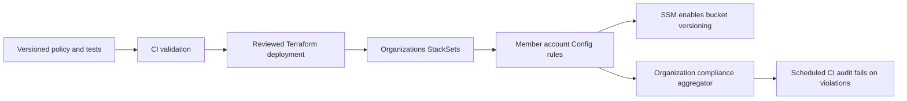

# Multi-account AWS policy as code

This is a future real-AWS deployment reference. The current target is LocalStack;
use [LocalStack account governance](../local-cloud-infra/governance/README.md) to
test live resource detection and remediation without real account or OU details.

This project governs existing and future resources in selected AWS Organizations
member accounts. It does not provision or import workload buckets. The first
policy is: **every recorded S3 bucket must have versioning enabled**.

The Terraform deployment creates a service-managed CloudFormation StackSet and
organization Config aggregator. Each selected account/Region receives an AWS
Config rule and Systems Manager remediation configuration. Disabled or suspended
versioning is detected and the AWS runbook enables it. New accounts joining the
selected organizational units automatically receive the controls.



## What is maintained as code

- [S3 versioning policy and remediation](templates/s3-versioning.yaml): resource
  scope, managed rule, versioned runbook, automatic-remediation setting and IAM.
- [Terraform](terraform/main.tf): target OUs/Regions, account enrollment and
  organization-wide compliance visibility.
- [Validation and audit workflow](../.github/workflows/account-governance.yml):
  policy safeguards, mocked deployment tests and optional live audit.

This is corrective enforcement, not an instantaneous API deny. AWS Config
evaluates recorded configuration changes; SSM repairs noncompliant buckets after
detection. The aggregator is eventually consistent. Existing Terraform owners
must also set their bucket versioning to `Enabled`, or a later Terraform apply
can suspend it and remediation will enable it again. Manual buckets remain owned
by their existing teams. Versioning affects subsequent object versions; it does
not reconstruct previously overwritten objects. Noncurrent versions consume
storage until lifecycle rules or explicit deletion remove them.

## Prerequisites and scope

1. AWS Organizations with all features and CloudFormation StackSets trusted
   access enabled. Run Terraform from the management account or a registered
   StackSets delegated administrator (`call_as = "DELEGATED_ADMIN"`).
2. AWS Config recording active for `AWS::S3::Bucket` in every target account and
   Region, including newly enrolled accounts. Reuse your landing zone's Config
   recorder and delivery channel; this code does not replace existing recording
   infrastructure. A Config/StackSets bootstrap must be part of account vending.
3. Organization Config aggregation permissions/trusted access and, when using a
   delegated account, the appropriate Config delegated-administrator registration.
4. Real AWS credentials for deployment and a protected, persistent Terraform S3
   state backend. The provider restricts deployment to `governance_account_id`.

Service-managed StackSets exclude the organization management account. Deploy
the same template separately there if required. Only configured Regions and
accounts in the selected OUs are governed; add new Regions explicitly. Only
resource types supported and recorded by AWS Config are evaluated. This S3 rule
covers general-purpose S3 buckets, not an unsupported bucket type by assumption.
Accounts removed from the OUs retain the deployed controls by default.

## Validate without accessing AWS

From `account-governance`, with Terraform >=1.7, Conftest 0.71.1 and Node.js:

```sh
conftest verify --policy policy --rego-version v1
conftest test templates/s3-versioning.yaml --policy policy --rego-version v1
terraform -chdir=terraform init -backend=false
terraform -chdir=terraform fmt -check -recursive
terraform -chdir=terraform validate
terraform -chdir=terraform test
node --test scripts/audit-compliance.test.cjs
```

CI performs these checks on pushes and pull requests with no AWS credentials.
Require **Account governance policy gate** in branch protection to block merging
failed policy changes. The existing LocalStack workflow remains a separate
project-specific plan gate.

## Prepare a reviewed deployment

Copy `terraform/terraform.tfvars.example` to your deployment-specific variables
file. Replace the example account and OU IDs and choose every relevant bucket
Region. `automatic_remediation = true` enables versioning on existing and future
noncompliant buckets; set it to `false` for a detection-only rollout.

Supply an existing remote state bucket/key/Region through backend configuration:

```sh
terraform -chdir=terraform init \
  -backend-config="bucket=YOUR-TERRAFORM-STATE-BUCKET" \
  -backend-config="key=account-governance/terraform.tfstate" \
  -backend-config="region=YOUR-STATE-REGION" \
  -backend-config="encrypt=true" \
  -backend-config="use_lockfile=true"
terraform -chdir=terraform plan -var-file=deployment.tfvars -out=governance.tfplan
```

Review the plan before applying. After approval, apply that saved plan:

```sh
terraform -chdir=terraform apply governance.tfplan
```

`deployment.tfvars` is resolved relative to the Terraform directory. It should
contain configuration, never credentials. The supplied IDs are examples only;
this repository has not been deployed, committed or pushed by this work.

## Enable the live CI compliance audit

After deployment, configure a read-only GitHub OIDC role in the governance
account. Restrict its trust to this repository's approved branch/workflow context.
It needs `cloudformation:ListStackInstances` and
`config:DescribeAggregateComplianceByConfigRules`; use a separate deployment
identity for creating or updating controls. Set these repository variables:

| Variable | Value |
| --- | --- |
| GOVERNANCE_AUDIT_ENABLED | `true` after setup |
| GOVERNANCE_AUDIT_ROLE_ARN | Read-only OIDC role ARN |
| GOVERNANCE_CONTROL_REGION | Region containing StackSet and aggregator |
| GOVERNANCE_CALL_AS | `SELF` or `DELEGATED_ADMIN` |
| GOVERNANCE_STACK_SET_NAME | Terraform `stack_set_name` output |
| GOVERNANCE_AGGREGATOR_NAME | Terraform `aggregator_name` output |
| GOVERNANCE_RULE_NAME | Terraform `config_rule_name` output |

The real-AWS audit script is retained for future use; the current workflow runs
LocalStack tests and does not assume a real AWS role or schedule real-AWS audits.
After real deployment, run `node scripts/audit-compliance.cjs` with the variables
above, or wire it into a reviewed scheduled workflow. It reads all StackSet
account/Region deployments and compares their Config compliance. A violation,
unsuccessful deployment, API error, empty scope or missing evaluation causes exit
code 1. Initial Config
evaluations and aggregation can take time. Accounts with no evaluation data,
including those with no applicable buckets, are reported as unknown rather than
silently passing. An audit cannot fix a disabled recorder; maintain that service
through your landing-zone controls. It does not block unrelated teams' pipelines
or console operations; their deployment gates must be configured separately.

## Extend the baseline

Add another Config rule and its remediation action to the template, with a
versioned runbook and narrowly scoped permissions. Add safeguard tests, review
the deployment plan and update the StackSet. Extend the audit to include that
rule before treating it as organization-wide coverage. The example currently
implements S3 versioning only; it does not claim your other existing compliance
policies have been incorporated. Keep approved exceptions explicitly scoped in
the rule/target configuration rather than silently bypassing failed checks.

AWS references: [S3 versioning Config rule](https://docs.aws.amazon.com/config/latest/developerguide/s3-bucket-versioning-enabled.html),
[versioning runbook](https://docs.aws.amazon.com/systems-manager-automation-runbooks/latest/userguide/automation-aws-configures3bucketversioning.html),
[versioning remediation walkthrough](https://aws.amazon.com/blogs/storage/automate-amazon-s3-versioning-using-aws-config-rules/).
